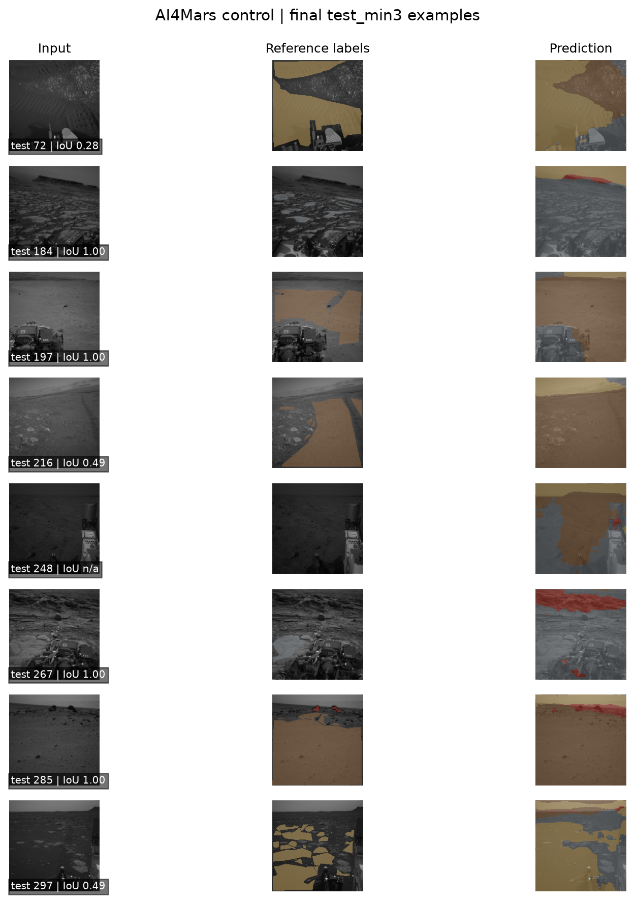

# AI4Mars Terrain Segmentation

A reproducible four-class Mars rover terrain segmentation project. The main experiment compares the same compact U-Net with no augmentation and with paired, label-safe augmentation.

[Try the quick AI4MARS model demo in Google Colab](https://colab.research.google.com/github/CatLover9463/ai4mars-segmentation/blob/main/ai4mars_walkthrough.ipynb).

## Environment

Use Python 3.10 or newer. This project uses `uv`; on Windows/Linux, `pyproject.toml` pins PyTorch to its CUDA 13.0 wheel index so an NVIDIA GPU can be used.

```powershell
uv sync
uv run python -c "import torch; print(torch.cuda.is_available(), torch.cuda.get_device_name(0) if torch.cuda.is_available() else 'CPU')"
```

Keep the NVIDIA driver current. The project also runs on CPU, though training will be slower.

## Dataset and split

The public dataset is `hassanjbara/AI4MARS`. Hugging Face downloads and caches it on first use. The four source mask IDs map to Soil (0), Bedrock (1), Sand (2), and Big rock (3); void and unknown values map to ignore index 255. The dataset schema has no scene/group identifier, so the train/validation split is record-level and fixed by seed. The exact indices and dataset fingerprint are versioned in `outputs/splits/ai4mars_seed0.json` and copied into each run folder.

Training uses the dataset's `train` partition for an 80/20 train/validation split. The official `test_min1`, `test_min2`, and `test_min3` variants contain the same test images with different levels of annotation agreement, so the final one-shot evaluation uses only `test_min3` (the strictest agreement version). Do not inspect any test metrics while tuning. See the [dataset card](https://huggingface.co/datasets/hassanjbara/AI4MARS) for the variant definitions.

## Matched experiment

Both runs use the same seed, split, 192×192 image size, U-Net width, optimizer, batch size, worker count, and 20-epoch cap. The lower resolution was chosen to reduce local training time while preserving the full model width; report it as an experimental choice.

Compute the majority-class baseline first. This also creates the shared split manifest used by both model runs:

```powershell
uv run python baseline.py --image-size 192 --seed 0
```

The baseline summary is saved to `results/majority_baseline_192.json`.

Control, without augmentation:

```powershell
uv run python train.py --epochs 20 --batch-size 16 --workers 2 --image-size 192 --output-dir outputs/ai4mars_192_b16
```

Augmentation, using the same saved split:

```powershell
uv run python train.py --epochs 20 --batch-size 16 --workers 2 --image-size 192 --augment --output-dir outputs/ai4mars_192_b16_aug
```

The augmentation applies the same horizontal flip and small rotation to each image/mask pair, then applies modest brightness/contrast changes to the image only. Validation mIoU selects the best checkpoint; pixel accuracy is supplementary. Review the per-class IoU and confusion matrix as well as mIoU.

After both runs finish, compare their full validation metrics and create validation-only overlays:

```powershell
uv run python analyze_validation.py --control outputs/ai4mars_192_b16/best.pth --augmentation outputs/ai4mars_192_b16_aug/best.pth
```

For one local rover image, use the selected checkpoint saved at `models/ai4mars_best.pth`:

```powershell
uv run python predict.py path\to\rover_image.jpg
```

## Results

We selected the no-augmentation control using validation mIoU, then evaluated it once on the strict `test_min3` split. The test set contains 322 records and 4,112,072 valid labeled pixels.

| Model | Test mIoU | Pixel accuracy | Big Rock IoU |
| --- | ---: | ---: | ---: |
| U-Net (selected control) | **0.8153** | **0.9704** | **0.4639** |
| Majority-class baseline | 0.0560 | 0.2240 | 0.0000 |

Validation mIoU was 0.7712 for the control and 0.7606 for augmentation, so the control was selected before looking at test results. The test metrics are reported for the selected model and the training-derived baseline; test results were not used to choose between runs.

<p align="center">
  
</p>

The overlay shows eight test examples side by side with their reference labels and predictions. Full per-class metrics and the confusion matrix are available in `results/final_test_metrics.json`.

## Final test evaluation

After choosing control or augmentation by validation mIoU and freezing all settings, evaluate that selected checkpoint once. The report also evaluates the training-derived majority baseline on the same test split:

```powershell
uv run python evaluate.py --checkpoints models/ai4mars_best.pth --output results/final_test_metrics.json
```

The evaluator uses only `test_min3`, accepts exactly one validation-selected checkpoint, and refuses to overwrite an existing report or overlay. It reports per-class IoU, mIoU, pixel accuracy, valid pixel count, and confusion matrix for the selected model and majority baseline. It saves eight test overlays during that same final evaluation. Do not use test results to revise the model.

## Outputs and resume

Each run saves `best.pth`, `latest.pth`, `training_history.json`, `run_config.json`, and its split manifest under `outputs/`. Those local training artifacts are git-ignored. Keep concise result summaries and visualizations under `results/` for version control. Resume a run with `--resume`; `--epochs` remains the total target epoch count.

The `ai4mars_walkthrough.ipynb` notebook is a quick Colab demo: it loads a capped sample of the training data, trains a smaller U-Net for a few epochs, and displays predictions on its held-out validation split. It does not reproduce the full matched experiment or final test evaluation; use the standalone scripts above for those results.

## References

- R. Michael Swan et al., “AI4MARS: A Dataset for Terrain-Aware Autonomous Driving on Mars,” CVPR Workshops, 2021. [Paper](https://openaccess.thecvf.com/content/CVPR2021W/AI4Space/html/Swan_AI4MARS_A_Dataset_for_Terrain-Aware_Autonomous_Driving_on_Mars_CVPRW_2021_paper.html)
- [Hugging Face AI4MARS dataset card](https://huggingface.co/datasets/hassanjbara/AI4MARS), including the label schema and test annotation variants.
- Olaf Ronneberger, Philipp Fischer, and Thomas Brox, “U-Net: Convolutional Networks for Biomedical Image Segmentation,” MICCAI 2015. [Paper](https://arxiv.org/abs/1505.04597)
